# Livewave - Flutter Live Streaming App

A creator live streaming app built in Flutter: discover who is live, watch with real-time chat, hearts and coin gifts, then flip to the host side and go live with an engine you pick (Agora, LiveKit or WebRTC), moderate the room, and watch stream health (bitrate, FPS, latency, packet loss, reconnect with exponential backoff) as it happens.

## Demo

| iOS | Android |
|---|---|
| 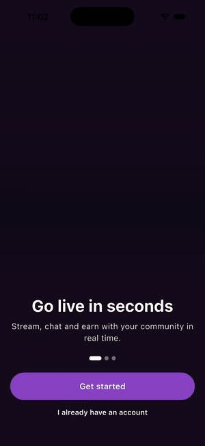 | 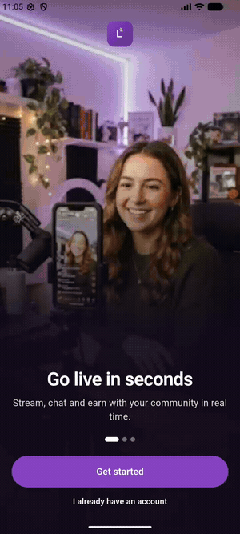 |

Same codebase running on both platforms.

## Screenshots

| Welcome | Home | Home - empty | Explore |
|---|---|---|---|
| 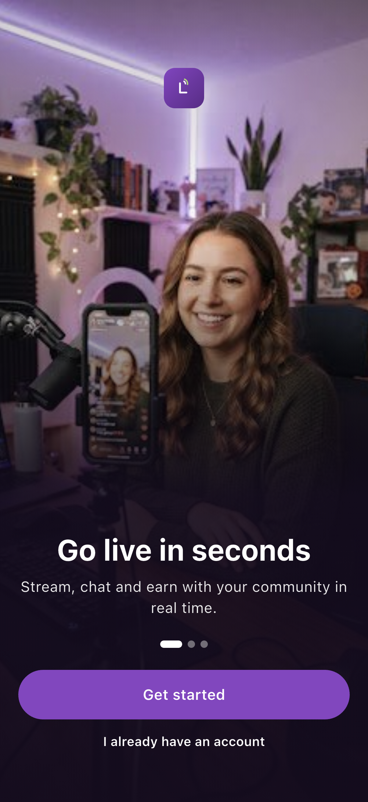 | 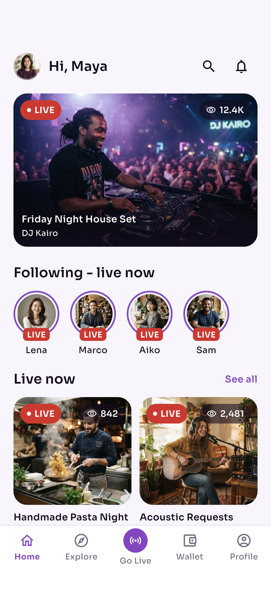 | 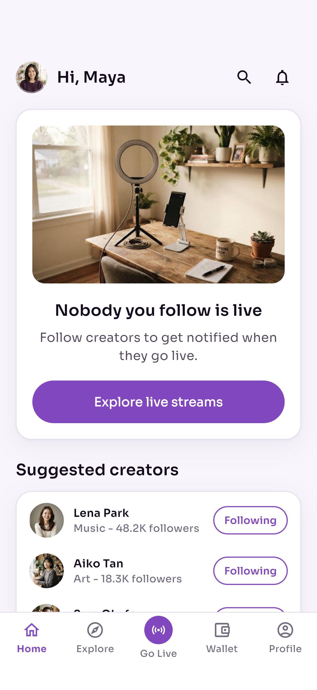 | 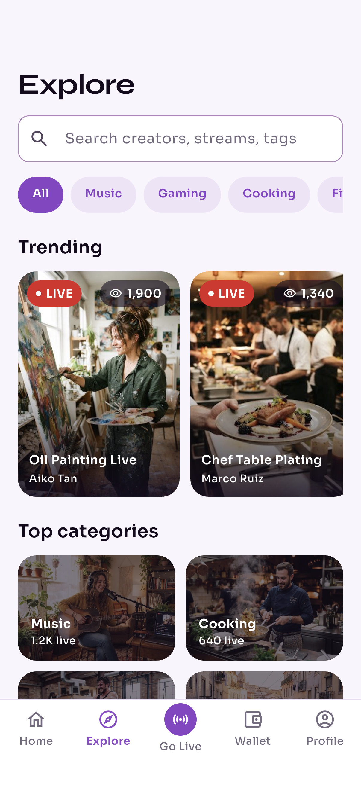 |

| Creator | Watch live | Gift sheet | Go live setup |
|---|---|---|---|
| 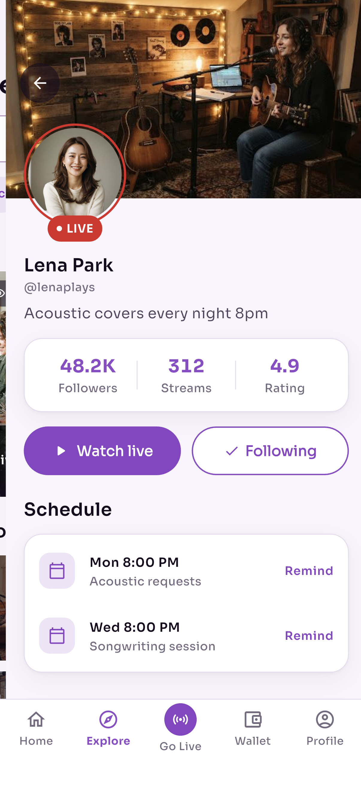 | 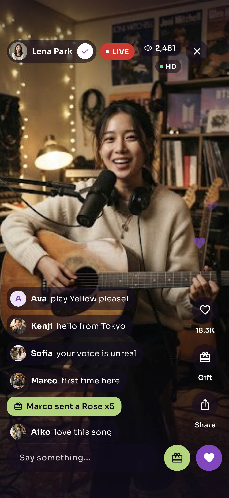 | 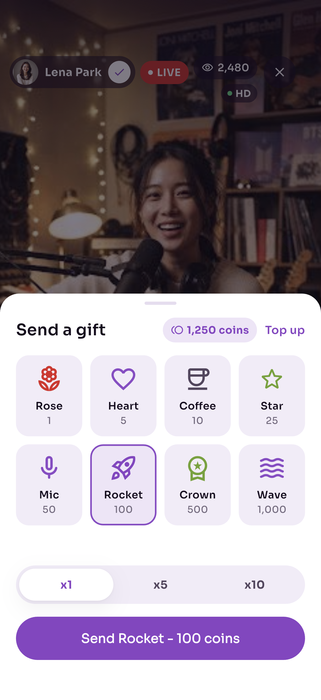 | 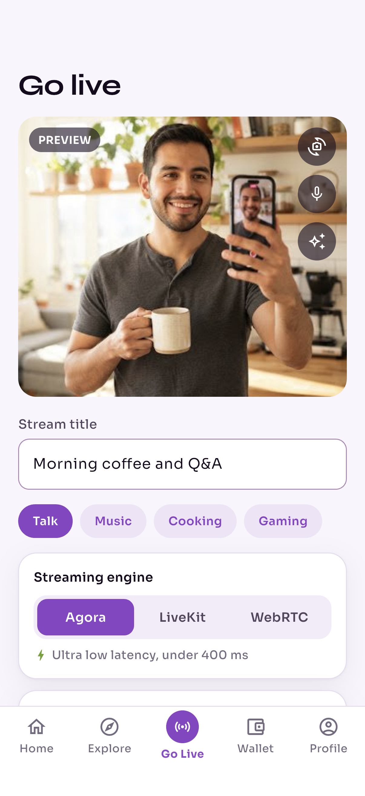 |

| Host room | Stream health | Summary | Wallet |
|---|---|---|---|
| 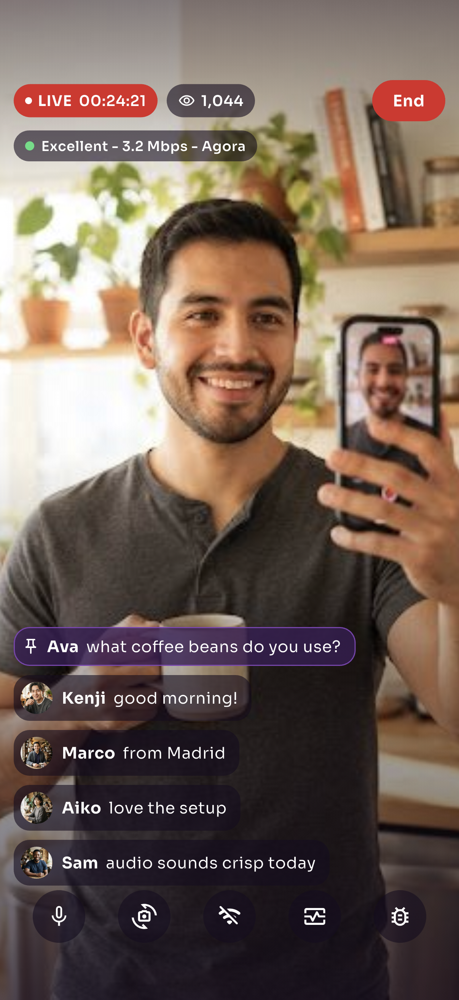 | 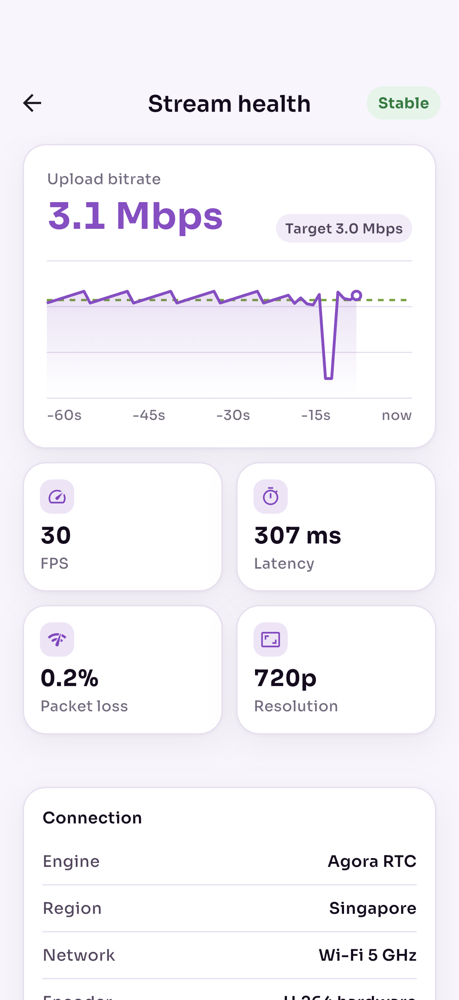 | 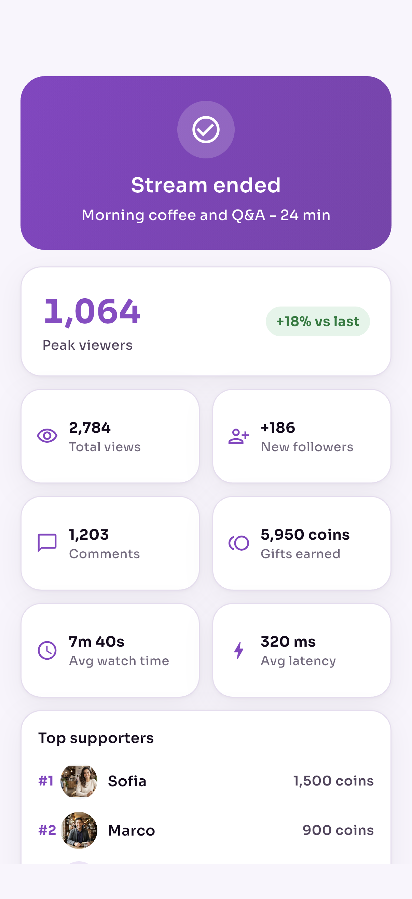 | 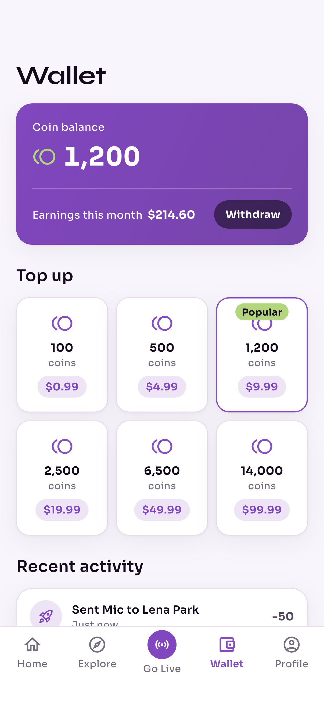 |

| Profile | Stream settings |
|---|---|
| 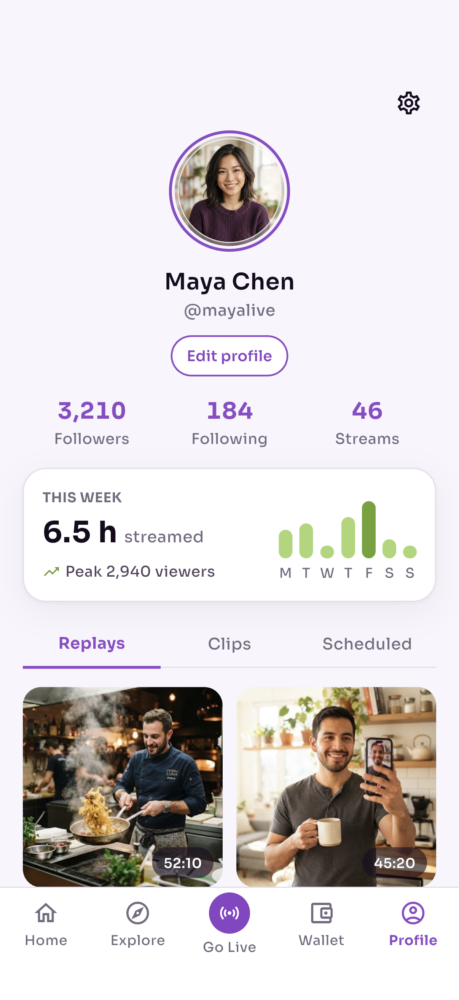 | 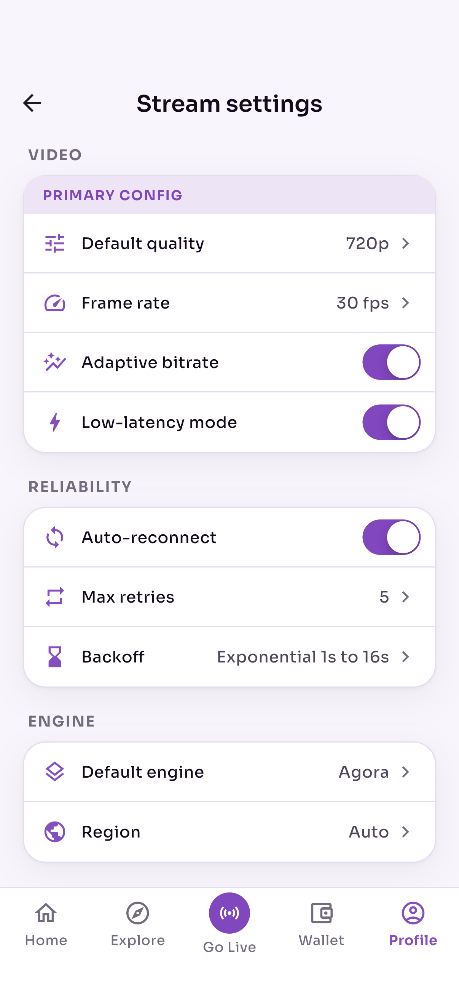 |

## App flow

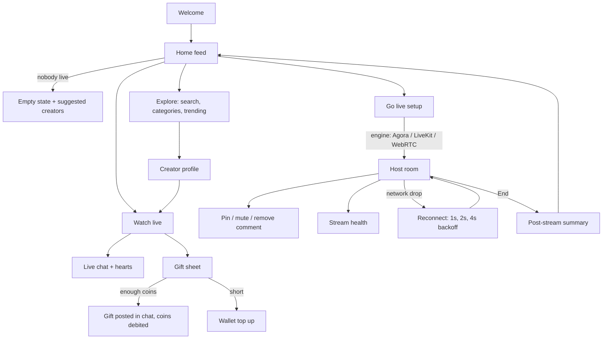

## What it shows

- **Viewer experience**: live feed, explore, creator page, full-screen watch view with a live comments overlay, viewer count, floating hearts and a gift sheet that checks the coin balance before sending.
- **Host experience**: pre-flight check, engine and quality choice, live timer, viewer count, gift alerts, comment moderation, mic toggle and a debug overlay with live fps / RTT / loss.
- **Reliability and QA**: stream health screen with a 60-second bitrate chart against target, metric tiles, connection details and a reconnect log. A one-tap network drop runs the full drop, retry and recover cycle so the backoff behaviour can be tested without a bad network.
- **Monetization**: coin wallet, six coin packs, earnings and transaction history.

## Architecture

```
lib/
  app/        theme tokens (LW), go_router config
  data/       models + mock data
  streaming/  StreamEngine interface, SimulatedEngine, ReconnectPolicy, StreamStats
  state/      Riverpod notifiers: wallet, follows, viewer room, go-live config,
              host session, settings
  widgets/    LIVE pill, viewer pill, comment bubble, stream card, tab shell,
              floating hearts, gift glyphs
  screens/    14 screens
```

- **Engine is an interface.** Screens and state only talk to `StreamEngine` (`start`, `stop`, `stats`, `reconnects`). `SimulatedEngine` drives the demo; an Agora, LiveKit or flutter_webrtc adapter drops in behind the same contract without touching the UI.
- **Host session owns the engine.** `HostSessionNotifier` starts the engine, subscribes to stats and reconnect events, keeps the last 60 bitrate samples for the chart, and tears everything down on End.
- **Reconnect policy is pure Dart.** `ReconnectPolicy.delayFor(attempt)` returns 1s, 2s, 4s, 8s, 16s, then null when retries run out. It is unit tested.
- **Viewer room is a realtime channel stand-in.** A ticker appends chat, nudges the viewer count and spawns hearts, the same shape a WebSocket or RTM channel would push.

## Tests

`flutter test` covers the backoff schedule, the health classifier (Excellent / Fair / Poor / Reconnecting), the simulated engine's drop, retry and recovery sequence, and the wallet spend / refuse / top-up rules. Screenshots above come from an `integration_test` run on the iOS Simulator.

## Run

```sh
flutter pub get
flutter run
```

No SDK keys, camera or backend needed: video is mocked with photos, and stats come from the simulated engine.

## Design

Screen designs, tokens and the logo live in [`design/`](design/). Palette: fresh purple `#8E4BC7` with pistachio `#A8D672`, Sora for UI and Syne for display.
